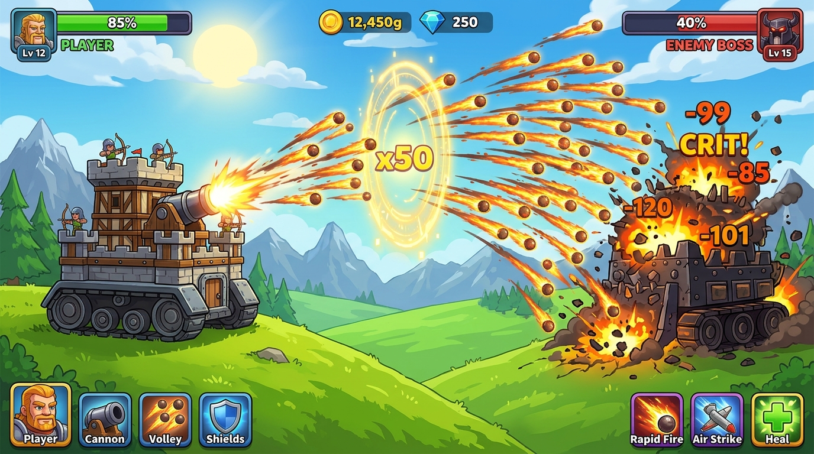
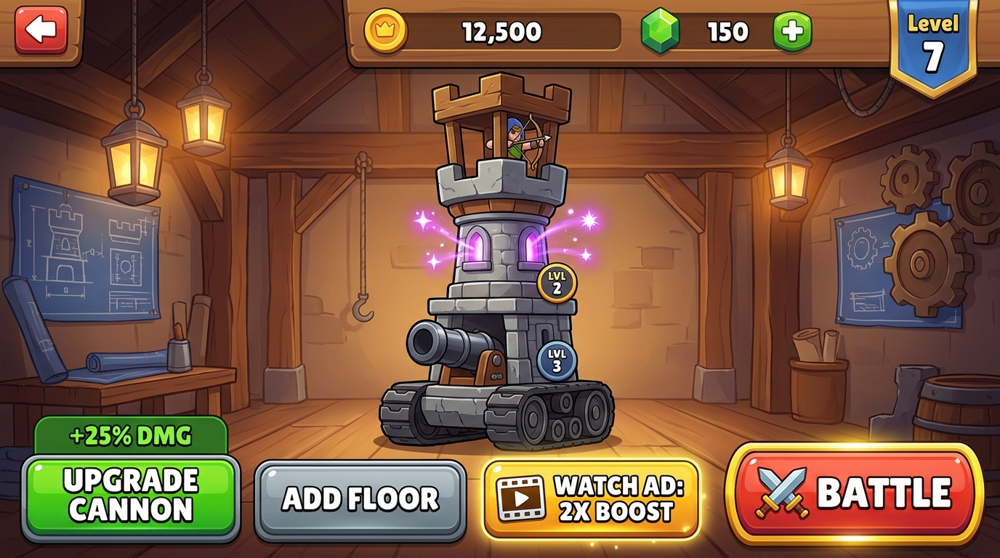

# 🏰 TOWER SIEGE: BULLET SWARM
### Complete Game Design Document (GDD) & Technical Blueprint
**Target Platform:** Android (Play Store) & iOS | **Orientation:** Landscape (16:9)  
**Engine:** Godot Engine 4 (2D - Compatibility / OpenGL3 Renderer)  
**Target Performance:** Stable 60 FPS on low/mid-tier mobile devices & dual-core PCs  

---

## 1. GAME CONCEPT & CORE VISION
**Tower Siege: Bullet Swarm** is a hyper-addictive, physics-based 2D castle artillery game that merges:
- **Strategic Trajectory Aiming** (Pull-back sling & arc prediction)
- **Satisfying Multiplier Gates** (1 cannonball turning into a 50+ meteor swarm)
- **Modular Physics Destruction** (Enemy castle crumbling block by block)
- **Dopamine-Driven Sound & VFX** (Damage numbers, screen shake, explosion chimes)

### Core Gameplay Loop
$$\text{AIM} \longrightarrow \text{HIT MULTIPLIER} \longrightarrow \text{SWARM METEORS} \longrightarrow \text{CRUMBLE ENEMY} \longrightarrow \text{COLLECT COINS / WATCH AD} \longrightarrow \text{UPGRADE CASTLE}$$

---

## 2. VISUAL CONCEPT ART
*(High-resolution assets available in `docs/art/`)*

### 🎮 In-Game Battle Action

- **Left:** Player's customizable Mobile Castle-Tank on treads.
- **Center:** Dynamic Floating Multiplier Ring (`x50`) hovering in the valley.
- **Action:** A single shot transforms into a devastating barrage of 50 flaming projectiles.
- **Right:** Enemy fortress taking massive damage (`-120`, `CRIT!`, `-99`) with crumbling physics blocks.

### 🛠️ Castle Garage & Upgrade Screen

- **Modular Tiers:** Cannon (Lvl 3), Wizard Tower (Lvl 2 with magical sparks), Archer Nest.
- **Monetization Hub:** Primary placement for Rewarded Video Ads (`WATCH AD: 2X BOOST`).
- **Clean Mobile UI:** Gold, Gems, and instant Battle launcher.

---

## 3. CORE GAMEPLAY MECHANICS

### 3.1 Slingshot / Trajectory Aiming
- Touch & drag behind player's main cannon to set **Angle** and **Power**.
- Visual dotted arc displays projectile prediction (truncated halfway to preserve player skill).
- Dynamic wind / gravity variations on higher levels.

### 3.2 Floating Multiplier Gate System
- Floating rings spawn at different altitudes between the two hills.
- **Gate Types:**
  - `x2` / `x5` (Green / Blue - Common)
  - `x10` / `x20` (Purple - Rare)
  - `x50` / `x100` (Golden Glowing - Jackpot)
  - `+10 Bombs` (Bonus Cluster Explosives)
- **Gate Movement:** Static in early levels, moving vertically or rotating in advanced levels.
- When projectile touches gate:
  - Spawns immediate audio chime (`ding-ding-ding`).
  - Original projectile duplicates into $N$ child projectiles with a realistic spread cone.

### 3.3 Modular Castle & Physics Destruction
- Each castle consists of stacked **2D RigidBody rooms & blocks** (Stone, Wood, Iron).
- When a room loses its HP:
  - Joints detach from adjacent blocks.
  - Room collapses with physical gravity, crushing units below it.
  - Debris and particle smoke burst on impact.

---

## 4. WEAPON & UNIT ARSENAL

| Unit / Weapon | Placement | Behavior | Upgrade Path |
| :--- | :--- | :--- | :--- |
| **Heavy Cannon** | Base Floor | High kinetic blast, heavy direct damage | Lvl 1 (Iron) $\rightarrow$ Lvl 5 (Plasma Titan) |
| **Fire Wizard** | Middle Tier | Splash AOE damage, sets wooden blocks on fire | Flame size & burn duration |
| **Archer Nest** | Top Tier | High-velocity precision puncture shots | Triple arrows, Poison arrows |
| **Catapult** | Back Slot | High-arc boulder toss, crushes roofs | Cluster boulder upgrade |
| **Nuke Booster** | Ad / Consumable | Giant tactical rocket obliterating entire floors | Unlocked via Rewarded Ad |

---

## 5. COMPLETE MONETIZATION BLUEPRINT (AdMob)

To maximize revenue while retaining 5-star ratings, non-intrusive **Rewarded Video Ads** are placed at natural high-dopamine breakpoints:

### 5.1 Rewarded Video Placements (80% Revenue)
1. **Post-Match 5x Multiplier:**
   - Base win: `Claim 100 Gold` vs `Watch Ad to Claim 500 Gold (5x)`.
   - *Expected Conversion: 60-70% of players.*
2. **Emergency Revive / Revenge Blast:**
   - When player HP reaches 0: *"Watch 1 quick ad to revive with 50% HP + Launch a Free 50x Mega Barrage!"*
3. **Pre-Battle Super Weapon:**
   - Before challenging a tough Boss level: *"Watch ad to equip Golden Dragon Cannon for 1 round."*
4. **Garage 2x Boost:**
   - Double offline earnings or get an instant 1,000 coin drop.

### 5.2 Interstitial Ads (Between Matches)
- Shown strictly **every 3 completed levels** or after 2 consecutive defeats.
- Never interrupts an active battle or aiming turn.

### 5.3 In-App Purchases (IAP)
- **"Remove Non-Rewarded Ads"** Pack ($1.99 / ₹99) — Disables forced banners and interstitials forever while keeping voluntary rewarded ads.

---

## 6. VIRAL UA (USER ACQUISITION) PLAYBOOK

Hyper-casual success relies on high Click-Through-Rate (CTR) short-form videos (TikTok, Instagram Reels, YouTube Shorts).

### The "Noob vs Pro" 10-Second Ad Script:
- **0:00 - 0:03 (Rage Bait / Hook):**
  - Top Screen (NOOB - IQ 50): Aims flat straight into the hill. Ball hits dirt and does zero damage. Red text: *"Why is this game so hard?! 😭"*
- **0:04 - 0:08 (Satisfaction / Dopamine):**
  - Bottom Screen (PRO - IQ 300): Perfect high arc right through the floating `x100` Golden Ring!
  - 100 fiery meteors rain down with heavy screen shake, obliterating the enemy castle into dust! Damage numbers `-500`, `MEGA WIN!` flash on screen.
- **0:09 - 0:10 (Call to Action):**
  - *"Can you hit the x100 gate? Download Free Now!"* with Play Store badge.

---

## 7. TECHNICAL ARCHITECTURE (Godot Engine 4)

### 7.1 Optimization for Low-End Hardware
- **Renderer:** `Compatibility` (OpenGL 3.0) — Guaranteed 60 FPS on Intel HD Graphics and low-end Android GPUs.
- **Physics Engine:** Godot 2D Physics server with fixed timestep (60 Hz).
- **Swarm Projectile Pooling:** Pre-allocated pool of 300 projectile nodes. Instead of instantiating new nodes per multiplier, existing pool nodes are reactivated and repositioned.

### 7.2 Core Node Hierarchy
```
MainScene (Node2D)
├── Environment
│   ├── ParallaxBackground (Sky, Mountains, Clouds)
│   ├── Terrain (StaticBody2D with CollisionPolygon2D)
│   └── MultiplierGate (Area2D with animated shader & particle rings)
├── PlayerCastle (CharacterBody2D on Wheels)
│   ├── Chassis (Wheels with PinJoint2D)
│   ├── Floor1_Cannon (AimController & ProjectileSpawner)
│   ├── Floor2_Wizard
│   └── Floor3_Archers
├── EnemyCastle (Modular RigidBody2D Hierarchy)
│   ├── BaseBlock
│   ├── MidBlock
│   └── RoofTower
├── ProjectilePool (Node2D - 300 pre-spawned Kinematic/Rigid projectiles)
├── Camera2D (Dynamic Zoom & Screen Shake script)
└── UILayer (CanvasLayer)
    ├── HealthBars (Player & Enemy Boss)
    ├── CoinDisplay
    └── GameOverModal (Rewarded Ad 5x Button)
```

---

## 8. 3-WEEK EXECUTION MILESTONES (3-Developer Team)

### Week 1: Core Physics & Trajectory Prototype
- [x] Godot 4 Environment setup.
- [ ] Implement Slingshot drag-and-aim trajectory line.
- [ ] Implement basic castle vehicle and terrain hill.
- [ ] Create Multiplier Gate collision and projectile duplication logic.

### Week 2: Modular Castle Destruction & VFX
- [ ] Create modular castle blocks that break on collision.
- [ ] Particle systems: Fire trails, smoke explosions, screen shake.
- [ ] Damage popup text (`FloatingNumbers.gd`).
- [ ] Basic enemy AI aiming logic.

### Week 3: Garage UI, Progression & AdMob
- [ ] Garage / Workshop screen with upgrade buttons.
- [ ] Google AdMob integration (Rewarded Video, Interstitial, Banner).
- [ ] Sound effects & victory music.
- [ ] Android APK Export and device testing.
