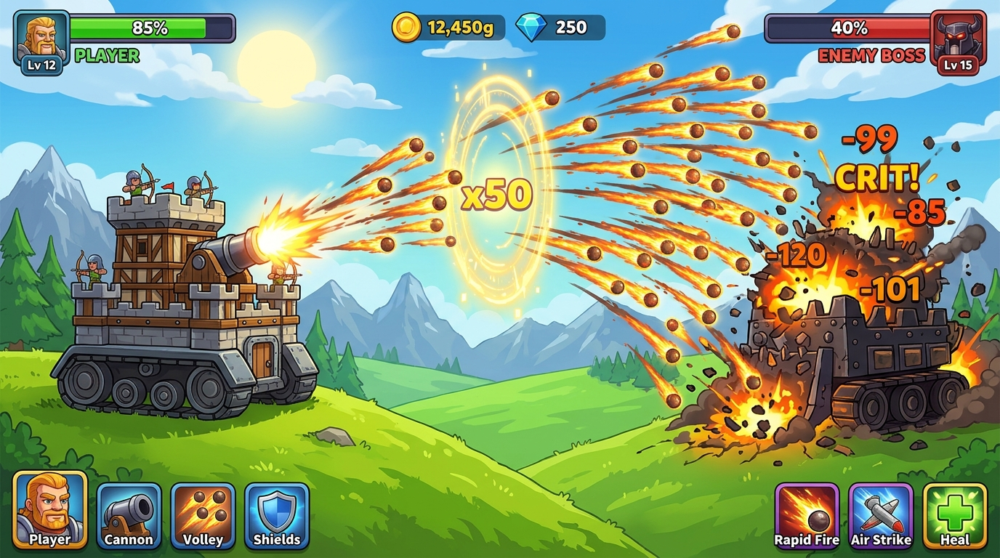
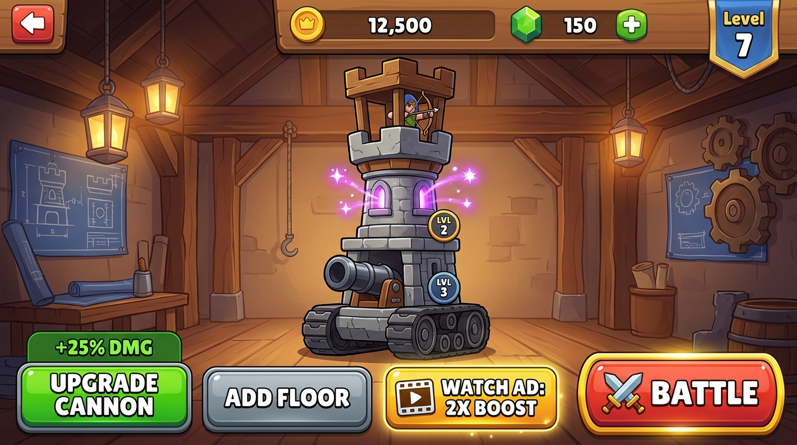

# 🏰 Tower Siege: Bullet Swarm
> A hyper-addictive 2D physics-based castle destruction game built with **Godot Engine 4**.

[]()
[-blue.svg)]()
[]()

---

## 📖 Complete Game Design Document (GDD)
Detailed mechanics, multiplier gates, AdMob monetization strategies, and viral video ad scripts are documented in:
👉 **[GAME_DESIGN_DOCUMENT.md](GAME_DESIGN_DOCUMENT.md)**

---

## 🎨 Visual Concept Preview
| 🎮 In-Game Battle (x50 Multiplier Swarm) | 🛠️ Garage & Upgrades (Rewarded Ads) |
| :---: | :---: |
|  |  |

---

## 🚀 Key Features
- **Trajectory Aiming:** Drag-and-release artillery mechanics.
- **Multiplier Gates:** Shoot through `x5`, `x20`, `x50`, `x100` rings to rain destruction.
- **Block-by-Block Physics Destruction:** Watch enemy towers collapse with real gravity and debris.
- **Google AdMob Monetization:** Smart rewarded video placements (5x coins, emergency revives).
- **Engineered for 60 FPS:** Optimized Godot 4 2D compatibility renderer for smooth performance on all devices.

---

## 👥 Team
- **Owner / Lead:** [@raj0413](https://github.com/raj0413)
- **Collaborator 1:** *(Invite Pending)*
- **Collaborator 2:** *(Invite Pending)*

---

## 🛠️ Getting Started with Godot
1. Clone this repository:
   ```bash
   git clone https://github.com/raj0413/game-arena.git
   cd game-arena
   ```
2. Launch Godot Engine 4 (`D:\Godot\godot.exe`).
3. Click **Import** and select the `project.godot` file in this directory.

Happy Developing! 🚀
